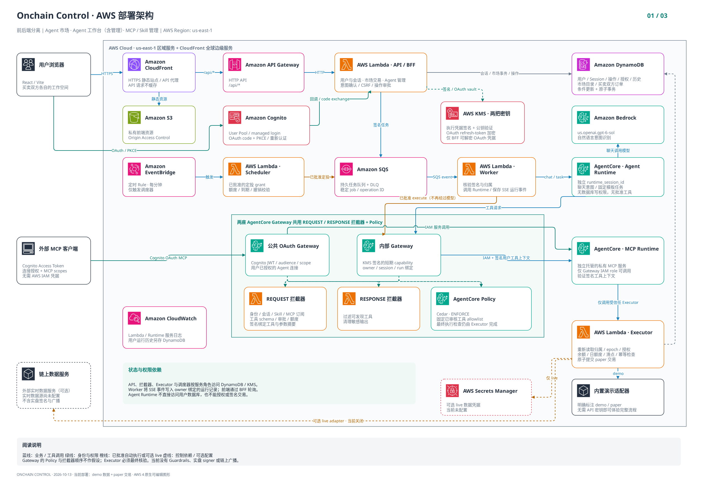
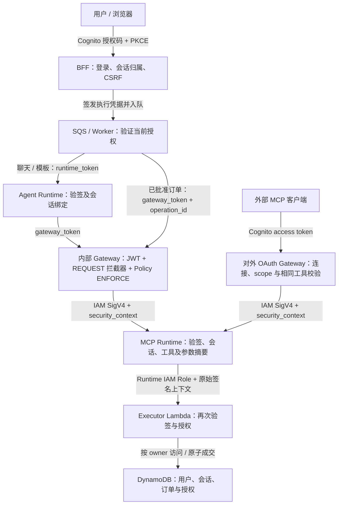

# Onchain Control

前后端分离的 Agent 平台：AWS AgentCore Runtime + Gateway、Bedrock GPT-6 Sol、Cognito 用户认证、MCP、意图识别、操作审批与确定规则拦截。**未使用 Guardrails。**

前端为 React/Vite，独立部署到私有 S3 + CloudFront；后端为 FastAPI/Lambda；Agent 与 MCP 使用不同的 AgentCore Runtime。CloudFront 的 `/api/*` 行为转发独立 API，浏览器使用 HttpOnly 会话 Cookie，模型凭据不进入前端。

已部署网站：<https://d2omddnartt627.cloudfront.net>。资源与验收方法见 [部署记录](docs/deployment.md)。

## AWS 架构图

[可编辑 draw.io 文件](docs/diagrams/onchain-architecture.drawio)使用 AWS 原生风格图标，包含三页：
整体部署、交易认证与拦截、用户与 Session 隔离。
[查看 PNG 预览与编辑说明](docs/diagrams/README.md)。



## 已实现

- Cognito managed login：OAuth 授权码 + PKCE、注册、密码恢复及 TOTP MFA。
- 对外 MCP OAuth Gateway：原生授权发现、Cognito Access Token 与 audience 校验、细分 scope、用户主动绑定/撤销 Agent 连接。
- 操作级重新认证，审批绑定用户、操作 ID、不可变意图摘要和有效期。
- 单笔交易点击“验证并执行”后自动提交，聊天卡片显示实时状态与成交回执；提交失败可沿用原操作重试。
- 用户/租户数据分区，服务端 Session 归属校验，独立 Runtime session，以及 microVM 内身份绑定。
- Bedrock `us.openai.gpt-6-sol` 意图识别；严格 schema 校验；模型不能批准交易。
- 独立 MCP Runtime：行情、持仓、交易准备、已批准交易执行、历史查询。
- Gateway REQUEST/RESPONSE Lambda 拦截器、JWT 验证、Policy ENFORCE、工具发现过滤。
- 固定版本 MCP 目录、用户启停订阅、经审核 Skill 与工具权限绑定。
- Agent 创建、模板选择、运行、暂停/恢复与删除；删除撤销旧凭据、持续授权和待执行操作，保留审计历史。
- 模拟交易、原子日额度、重复执行幂等、定投持续授权、撤销授权、定时调度。
- 用户审计中心、拦截验证、操作历史导出。
- Agent 历史会话、刷新恢复、只读历史回看，以及实时 Bedrock/Gateway/MCP/tool 运行时间线。
- Agent 服务市场：卖家发布已审核任务或定投策略，买家经 Cognito 确认购买，双边模拟费用原子结算，创建买方独立 Agent；任务从工作台运行，定投按明确授权自动执行。
- 15 个任务模板、8 个 MCP 产品、18 个工具和 10 个 Skill；覆盖下单、持仓分析、交易预检、代币研究、K 线、风险、信号与兑换路由。
- CloudFormation + AgentCore 部署脚本，安全单元测试和双用户浏览器验收。

## 交易边界

当前版本默认且仅允许 **paper 模拟执行**，初始每用户 10,000 USDC。模拟钱包、成交和参考价格在 UI 与接口中明确标记，不会提交链上交易，不伪造交易哈希。

「Agent 工作台 → 交易下单」提供 Base 上 USDC → ETH 买入和 ETH → USDC 卖出的模拟市价单。先选择具有执行权限的 Agent，再填写金额和滑点，
点击「生成待确认订单」，Agent 经 Gateway/MCP 读取余额、查询报价并准备订单。
在原会话核对参考价和最低接收数量，通过 Cognito 验证后自动成交；余额、持仓和订单回执同步更新。
「订单历史」支持状态筛选、查看会话和撤回尚未执行的订单。新订单的价格下限绑定到用户确认的意图摘要；
执行时价格超出批准范围、余额不足或日额度耗尽都会阻止成交，重复执行不会重复扣款。
也可从「Agent 工作台 → 任务模板 → ETH 买入下单」创建专用 Agent。新增 `eth-buy` / `eth-sell` 模板和独立方向 Skill；卖出填写 ETH 数量，必须已有持仓，买入授权不能用于卖出。详见 [下单场景](docs/order-scenarios.md)。

默认 `ONCHAIN_DATA_MODE=demo`，无需 OKX Key 即可运行全部任务模板。十个链上研究工具返回明确标注的合成演示数据，模拟交易使用 3,000 USD/ETH 参考价；Cognito、Bedrock、AgentCore Runtime、Gateway 和 MCP 均正常运行，认证与授权不会被跳过。真实数据需显式设置 `ONCHAIN_DATA_MODE=live` 并配置 `OKX_SECRET_ARN`，秘密结构为 `api_key`、`secret_key`、`passphrase`。真实数据模式失败不会回退到演示数据。实盘签名、用户钱包绑定和真实资金执行尚未实现，`TRADING_MODE` 设置为其他值会拒绝启动。

MCP 市场是可用的、平台维护的工具目录；不执行用户上传的 Skill 代码，不自动发布第三方远程 MCP。完整第三方商业市场、支付结算及任意链/币种不在本版本范围内。

## 对外 MCP OAuth

登录后打开「MCP / Skill 管理」，在「外部 MCP · Cognito OAuth」中选择 Agent 与权限，
通过 Cognito 重新认证完成连接授权。面板提供 MCP 地址、客户端 ID 和 OAuth 参数。
连接默认只读，交易准备和执行需要分别开启；允许执行也不能替代具体交易的用户确认。

外部客户端无需 IAM 凭据。Gateway 原生验证 Cognito 令牌，拦截器校验连接、scope、Skill、
订阅和审批。Gateway 到受 IAM 保护的 MCP Runtime 的服务调用仍使用 IAM；用户身份由已验证的
工具执行上下文传递。内部 Worker/定投调度使用独立的受限执行凭据。

仓库提供可运行的 PKCE 客户端：`scripts/mcp_oauth_client.py`。客户端需使用固定回调
`http://localhost:8765/callback`；暂不提供动态客户端注册。详见 [OAuth MCP 接入](docs/oauth-mcp.md)。

## Runtime → Gateway → MCP 的认证与用户隔离

以下描述当前实现。用户使用 Cognito 登录，后端为该用户的会话签发受限执行凭据；
Agent Runtime、Gateway 和 MCP Runtime 分别验证自己的入站请求，Executor 在访问数据或成交前再次校验。
**IAM 验证服务调用身份；签名执行上下文和服务端记录验证用户、会话与操作权限。**
用户登录、工具调用权限、具体交易批准是三个独立条件；模型识别出的意图不能授予权限。

### 调用路径与凭据



图中 REQUEST 拦截器与 Policy 是两项必须满足的检查，不假定它们在 AWS 内部的先后顺序。
返回结果经过 Gateway RESPONSE 拦截器过滤和脱敏后进入原用户的运行时间线。

| 凭据 | 签发方与传输位置 | 接收方 / 有效期 |
|---|---|---|
| Cognito access token | Cognito；网页由 BFF 保管，外部 MCP 客户端使用自己的 token 调用对外 Gateway | 验证 Cognito issuer、client、资源 audience、scope；当前 access token 为 15 分钟 |
| `runtime_token` | BFF 入队时签发；Worker → Agent Runtime 的 `Authorization: Bearer` | `aud=onchain-runtime`，300 秒 |
| `gateway_token` | BFF 入队时签发；Agent Runtime 或 Worker → 内部 Gateway 的 `Authorization: Bearer` | `aud=onchain-gateway`，300 秒 |
| `security_context` | REQUEST 拦截器在工具授权通过后签发，注入下游工具参数 | MCP Runtime 和 Executor；`aud=onchain-tools`，120 秒 |
| Gateway IAM 临时凭证 | AWS 为 Gateway 服务角色管理，使用 SigV4 签名调用 MCP Runtime | AWS 服务调用认证；不表示某个终端用户，也不构成交易批准 |

三个内部 JWT 使用不同 audience，不能相互替代。定投调度器也签发受限执行凭据，其权限来自已批准的持续授权，
不能将网页登录的短期凭据当作永久授权。浏览器不接收这些内部 JWT，模型的提示词和工具描述也不包含它们。

### `security_context` 的实现

`security_context` 是本项目自定义的签名 JWT 字段，**不是 AgentCore 自动提供的用户隔离功能**。
生产环境通过 AWS KMS 的 RSA 密钥执行 RS256 签名，私钥不离开 KMS；Agent/MCP Runtime 只有获取公钥的权限，
没有 `kms:Sign` 权限。JWT 内容可解码，签名保护完整性而非加密内容，不应在其中放入密码或 API Key。

其主要字段如下；值全部来自已验证的身份、服务端记录或已通过校验的本次调用：

| 字段 | 绑定内容 |
|---|---|
| `sub`、`tenant`、`owner` | Cognito 用户与平台数据归属；个人租户为 `personal-{sub}`，`owner = SHA256(tenant + ":" + sub)` |
| `agent_id`、`sid`、`runtime_sid`、`run_id` | 当前 Agent、应用会话、Runtime 会话与本次运行 |
| `agent_epoch`、`session_epoch`、`skill_digest` | 授权版本与已审核 Skill；状态或版本变化后旧凭据不能继续授权工具调用 |
| `tool`、`arguments_hash` | 确切工具名与参数摘要；摘要使用键排序的紧凑 JSON 做 SHA256，执行订单 ID 也在摘要范围内 |
| `iss`、`aud`、`iat`、`nbf`、`exp`、`jti` | 签发方、接收方、生效与过期时间、随机凭证标识 |

交互调用还携带 Cognito scope 和过期时间等约束。用户数据分区的哈希只是稳定标识；
防止冒充依赖 Cognito 验证、KMS 签名和每次调用的服务端归属检查。
Agent 提交的额外 `userId`、接收地址或 `security_context` 参数会被公开工具 schema 拒绝；
只有 REQUEST 拦截器在授权通过后注入签名上下文。

### 每一层如何验证

1. **登录与入队。** BFF 验证 Cognito OAuth 回调并建立服务端登录，浏览器持有 HttpOnly Cookie。
   修改请求校验 CSRF；会话必须属于当前用户和当前登录。BFF 从数据库取得 Agent、会话和 Runtime ID，
   生成 `run_id`、签发两种执行 JWT 并入队。Worker 验签并重新检查当前会话和 Agent 授权。
2. **Agent Runtime 入站。** AgentCore JWT authorizer 和应用代码验证 Runtime 凭据。
   应用比较实际 `X-Amzn-Bedrock-AgentCore-Runtime-Session-Id`、请求体 Runtime ID、`run_id` 与签名 claims；
   进程内 `SessionBinding` 锁定 `(owner, sid, runtime_sid)`。模板还校验任务参数摘要与模板版本。
   Bedrock 仅生成受 schema 约束的意图；每次 Gateway 调用创建新的 MCP 客户端会话，不跨用户共享客户端。
3. **Gateway 入站与 REQUEST 拦截器。** 内部 Gateway 验证平台 JWT；对外 Gateway 验证 Cognito JWT。
   拦截器再验证身份和当前授权，检查用户/Agent/会话归属、状态、epoch、Skill、OAuth scope、
   MCP 订阅、工具白名单、参数 schema、速率和操作权限。内部 MCP session 绑定 `(owner, sid, run_id)`，
   不能在其他用户、会话或运行之间复用。通过后签发 `security_context`。
4. **Policy 与 IAM 服务调用。** Cedar Policy 在 `ENFORCE` 模式限制平台工具；动态用户权限由拦截器和 Executor 检查。
   Gateway 以 `GATEWAY_IAM_ROLE`、`service=bedrock-agentcore` 调用 MCP Runtime。
   Runtime 与 DEFAULT endpoint 的资源策略允许 Gateway Role，显式拒绝其他 principal 的调用。
5. **MCP Runtime。** 验证 `security_context` 的 RS256 签名、issuer、audience、时间；
   再做进程内会话绑定，并比较实际工具名、参数摘要。检查通过才以自身 IAM Role 调用指定 Executor Lambda。
   MCP Runtime 没有数据库读写权限，也不能签发凭据。
6. **Executor 与成交。** Executor 独立验签、比较工具及参数摘要，再调用 `authorize_tool` 读取当前授权状态。
   查询钱包和订单只使用验证得到的 `owner`；订单还必须属于当前 Agent。
   执行交易时检查订单意图摘要、批准或持续授权、有效期、余额/持仓、报价、滑点和额度，
   原子更新用户状态并保存成交回执。依赖或校验失败会拒绝调用，不自动放行。
7. **返回与审计。** RESPONSE 拦截器按 Skill、订阅和外部 OAuth scope 过滤工具列表，
   隐藏工具 schema 中的 `security_context`，对 token、密钥等字段脱敏。
   Gateway/Executor 允许、拒绝及结果事件进入有用户归属检查的会话时间线。

以“用 20 USDC 买入 ETH”为例，聊天阶段最多生成 `PENDING` 订单。用户核对后经 Cognito 重新认证，
回调必须匹配原登录用户、订单和 `intent_hash`；BFF 消费 120 秒内的一次性证明后将订单批准。
随后 Worker **直接经 Gateway 调用 `execute_trade(operation_id)`**，不再让模型决定成交参数，
但仍经过 Gateway、MCP 和 Executor 的全部执行校验。`trade.execute` scope 或成功验签均不能代替订单批准。

### 用户隔离与实际边界

| 隔离对象 | 当前实现 |
|---|---|
| 用户与数据 | 由已验证的 Cognito `sub` 派生 `owner`，用户聚合保存于 `USER#{owner}`；订单 ID 只能在当前用户数据中查询 |
| 会话与历史 | 每个会话记录 owner、Agent、独立随机 Runtime ID、状态和版本；读取历史及运行结果也检查 owner |
| Runtime 执行环境 | 平台按会话指定 Runtime session；Agent/MCP 进程绑定首个用户与会话身份，身份变化立即拒绝 |
| 外部 MCP 连接 | 绑定 owner、OAuth client、token family、已批准连接及 MCP session；其他登录或被撤销的连接不能复用 |
| 买卖方 Agent | 购买创建买方拥有的独立 Agent；卖方无权读取买方会话或控制买方执行 |
| 失效与撤销 | 每次授权重读状态；退出使绑定该登录的会话失效，暂停/删除改变 Agent epoch，撤销 grant 阻止后续自动执行 |

典型拒绝场景：A 读取 B 的订单返回不可用；向工具参数注入 B 的身份触发 `INVALID_TOOL_ARGUMENTS`；
更换已签名的工具参数触发 `ARGUMENTS_CHANGED`；跨会话复用内部 MCP session 触发 `GATEWAY_SESSION_MISMATCH`；
Agent 状态/版本改变后旧授权不能继续使用。同一 Agent 在 60 秒内出现三次指定严重违规
（`OWNER_MISMATCH`、`INTENT_CHANGED`、`SKILL_CHANGED`、`INVALID_TOOL_ARGUMENTS`）会自动暂停并增加 epoch。

当前多个用户共享 Runtime 部署、服务 IAM Role 和 DynamoDB 表，**没有每用户独立 IAM Role、数据库或数据库层租户 ABAC**。
用户数据隔离依赖上述签名、会话及可信 Executor 的归属检查。两个 Runtime 当前配置 `networkMode=PUBLIC`；
MCP 是受 IAM 限制的后端端点，不是 VPC 私网端点，网络认证不替代用户授权。

`security_context` 是短期持有者凭证；`jti` 当前不做一次性消费，交易防重放依靠订单的原子状态转换与幂等回执。
停止旧会话不会自动撤销用户另行批准的定投 grant，应显式暂停 Agent 或撤销 grant。
输出脱敏不能撤回已发生的交易，因此成交前校验始终在 Executor 执行。

### IAM 与 OAuth 的选择

当前同平台的 Gateway → MCP Runtime 使用 IAM，AWS 管理服务临时凭证，用户绑定由签名上下文承担。
对外客户端入口已经使用 Cognito OAuth。下游也可以改为用户委托 OAuth，但目前**没有配置 outbound OAuth provider**：
`client_credentials` 仍代表服务身份；用户授权码方案需要下游授权、回调、连接绑定与令牌刷新，
并保留会话归属及交易批准检查。OAuth 令牌不能自动替代全部 `security_context` 业务约束。

AWS MCP target 支持 OAuth 授权码和 token exchange；后者还要求授权服务器支持对应 grant，
当前 Cognito token endpoint 不原生提供标准 token exchange。`JWT_PASSTHROUGH` 适用于 HTTP target，
不能直接用于本项目的 MCP server target。参考 [AWS MCP target 授权](https://docs.aws.amazon.com/bedrock-agentcore/latest/devguide/gateway-target-MCPservers.html)、
[target 凭据配置](https://docs.aws.amazon.com/bedrock-agentcore/latest/devguide/gateway-building-adding-targets-authorization.html)、
[Cognito grant 类型](https://docs.aws.amazon.com/cognito/latest/developerguide/token-endpoint.html)。

### 实现与验证入口

代码入口：[OAuth 身份](backend/onchain/oauth.py)、[入队签发](backend/onchain/api.py)、
[Worker](backend/onchain/worker.py)、[JWT 签发与验签](backend/onchain/security.py)、
[Agent Runtime](runtimes/agent.py)、[Gateway 拦截器](backend/onchain/interceptors.py)、
[MCP Runtime](runtimes/mcp_server.py)、[Runtime 身份绑定](runtimes/isolation.py)、
[Executor](backend/onchain/services.py)、[授权与订单归属](backend/onchain/domain.py)、
[IAM 权限](infra/template.py)、[Runtime 资源策略与 Gateway 配置](scripts/deploy.py)。

现有 [安全测试](tests/test_security.py) 和 [OAuth 测试](tests/test_oauth.py) 覆盖跨用户访问、
会话复用、参数替换、错误 audience、暂停/退出撤销、scope、批准绑定、并发额度和重复成交；
可在本地无 AWS 调用地运行：

```bash
.venv/bin/pytest -q tests/test_security.py tests/test_oauth.py
```

真实 AWS 登录与工具链路由 [OAuth 云端验收](frontend/tests/oauth-cloud.spec.ts) 覆盖，
买卖方隔离与订单确认由 [买卖 Agent 云端验收](frontend/tests/trade-market-cloud.spec.ts) 覆盖。
本地规则测试不能替代部署后的 IAM、Gateway 和 Runtime 验收；当前成交仍为 paper 模拟执行。

## Agent 市场与自动交易

平台包含三个主入口：「Agent 市场」「Agent 工作台」「MCP / Skill 管理」。
Agent 管理已并入工作台，可在「我的 Agents」「任务模板」「任务与会话」「交易下单」之间切换。
市场包含「发现 Agent」「我购买的」「卖方中心」，可按买入、卖出、自动定投及研究筛选，按服务费或销量排序。
卖家可在发布窗口直接从模板新建 Agent，核对任务、价格和能力后发布；也可发布已有 Agent。
买方核对模拟服务费、Skill 与 MCP 范围，经 Cognito 验证后获得独立 Agent 并进入工作台。
普通任务购买不创建交易授权；ETH 定投购买需额外确认交易预算与有效期，调度器才会自动执行。
工作台按 Agent 的 Skill 和任务模板展示示例动作；订单仅显示当前 Agent 的记录。
卖方只能看到销售订单和模拟收入，不能读取买方会话或控制买方 Agent。
详见 [Agent 市场](docs/agent-marketplace.md)。当前交易对象为 Agent 服务，资金与成交均为模拟。

## 历史会话与运行过程

「Agent 工作台 → 任务模板」可创建专用 Agent，并在工作台配置参数运行。多步骤任务会逐次调用真实
Gateway/MCP 工具，保留结果与运行时间线。当前运行免 Key 演示模式，所有模板均可使用。
选择「代币尽调报告」创建 Agent 后，直接用预填示例运行，即可查看资料、价格、持有人与风险扫描四个步骤。
交易需选择「受控交易」Agent；输入金额并确认操作后，Cognito 验证会返回原会话并自动完成模拟交易。
自动交易可使用「ETH 自动定投」模板，或从 Agent 市场购买策略并确认持续授权。
详见 [Onchain OS 能力与配置](docs/onchain-os-capabilities.md)。

打开「Agent 工作台」，左侧按当前 Agent 列出历史会话，支持搜索与切换；中间显示消息，
右侧显示每次运行的意图识别、MCP 连接、工具参数、Gateway 检查、执行结果、耗时与错误。
展开事件可查看已脱敏的参数和结果。页面位置按用户、按标签页保存，刷新后恢复上次选择的
Agent 和会话。从会话发起交易确认后，Cognito 认证会自动返回原会话，继续显示执行进度和
成交结果；其他标签页的选择不会覆盖此次返回位置。

新会话不会删除旧会话。退出登录、会话到期或 Agent 暂停后仍可回看本人历史，但不会恢复
旧会话的执行权限；点击「新会话」使用当前登录重新开始。

历史默认保留 30 天，每个 Agent 列出最近 100 个会话；每个会话保留最近 30 条消息和
30 次运行，每次运行最多 40 个事件，单个详情预览最多约 4 KiB。旧版会话没有被记录过的
运行事件不会被补造。现有云端历史已迁移；其他既有部署可运行：

```bash
.venv/bin/python scripts/backfill_history.py
```

## 本地运行

需要 Python 3.12、Node.js 22，以及可调用指定 Bedrock 模型的 AWS 凭据。

```bash
python -m venv .venv
.venv/bin/pip install -e '.[runtime,dev]'
.venv/bin/uvicorn onchain.api:app --host 127.0.0.1 --port 8000
```

另一个终端：

```bash
cd frontend
npm ci
npm run dev
```

打开 `http://localhost:5173`。仅本地模式提供两个隔离账号：

| 邮箱 | 本地密码 |
|---|---|
| alice@example.test | local-only-change-me |
| bob@example.test | local-only-change-me |

生产环境禁用本地认证。应用不会在模型不可用时悄悄替换模型或伪造推理结果。

本地 API 会通过相同的 REQUEST interceptor 规则校验工具请求，但不会声称正在运行 AWS Gateway/microVM；生产部署实际调用 Gateway 和 Runtime。

## 验证

```bash
.venv/bin/ruff check backend runtimes infra scripts tests
.venv/bin/pytest -q
cd frontend
npm run build
npx playwright install chromium
npx playwright test
```

浏览器测试需要本地前后端已启动，并会实际调用 Bedrock。单元测试不调用 AWS。

## 部署

```bash
.venv/bin/python scripts/build_backend.py
cd frontend
npm ci
npm run build
cd ..
.venv/bin/python scripts/deploy.py --region us-east-1
```

部署创建真实 AWS 资源并产生费用。输出记录在 `.deployment/resources.json`。该目录不提交到 Git。

仅更新前端：

```bash
.venv/bin/python scripts/deploy.py --frontend-only
```

更新应用和 Runtime 代码：

```bash
.venv/bin/python scripts/build_backend.py
.venv/bin/python scripts/deploy.py --skip-stack
```

云端双用户验收：

```bash
.venv/bin/python scripts/smoke_users.py
cd frontend
TEST_BASE_URL=https://YOUR_DISTRIBUTION.cloudfront.net npx playwright test
```

测试账号使用 `example.invalid`，通过管理接口创建，不发送邮件；密码只写入权限为 0600 的忽略文件。普通用户通过网页“创建账号”注册。
OAuth 云端验收由 `frontend/tests/oauth-cloud.spec.ts` 覆盖，验证真实登录、PKCE、刷新、
scope、跨用户与会话隔离、具体操作确认和撤销连接。旧版直接密码登录脚本仅记录迁移前
的 TOTP 等验收流程，不作为当前生产登录路径。

详见 [架构](docs/architecture.md)、[安全设计](docs/security.md)、[运维](docs/operations.md)。
