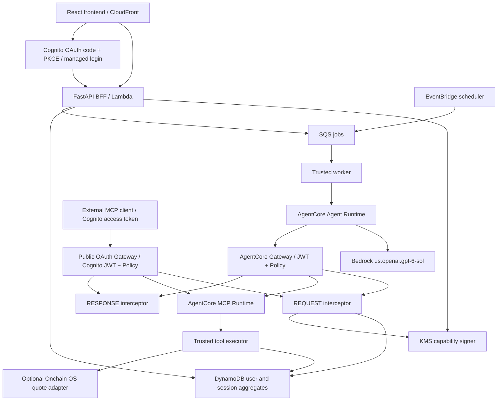

# Architecture

The frontend and backend have independent sources, build artifacts and deployment commands.
CloudFront proxies `/api/*` to the independently deployed HTTP API so auth cookies can remain same-origin.
API calls are never cached. Private S3 origin access is granted only to the distribution.

## Session identity

1. Cognito returns a fresh identity to the BFF; the BFF creates a server-side, one-hour login.
2. The browser receives only a random HttpOnly, Secure, SameSite=Strict session cookie and a CSRF token.
3. Every conversation has a distinct opaque ID and a different Runtime session ID.
4. Runtime routing identifiers and user IDs cannot be supplied through chat/tool arguments.
5. A KMS-signed runtime capability binds owner, conversation, runtime session, agent, skill digest and run.
6. A separate audience-bound Gateway capability carries the same verified binding.
7. Gateway sessions are tied to authenticated user identity. The interceptor additionally binds each MCP
   session to the conversation and run, preventing same-user cross-conversation reuse.
8. The request interceptor signs a short-lived tool capability bound to the exact tool and argument digest.
9. The MCP runtime verifies it and invokes a trusted executor. The executor verifies it again and rereads
   authoritative authorization state.
10. Both Runtime processes pin the first authenticated session identity for the lifetime of their microVM.

Agent Runtime has no database, KMS signing, wallet signing, or arbitrary Lambda execution permissions.
MCP Runtime can verify signatures and invoke exactly the trusted executor. Only API/interceptor/scheduler
roles may sign capabilities. The MCP runtime resource policy restricts invocation to the Gateway role.

## Durable state

DynamoDB stores one user aggregate for atomic portfolio/budget/operation transitions, and separate
records for login, conversations, gateway session bindings, job leases and rate buckets. Aggregate
updates use strongly consistent reads and conditional version writes. SQLite uses `BEGIN IMMEDIATE`
for the same local semantics. All monetary arithmetic uses integer micro-USDC and Decimal.

The current workspace bounds are ten agents, 200 retained operations, thirty messages per conversation,
and 150 recent audit events. The user can export/archive terminal trade operations. This bounded
single-aggregate design should be replaced with transactionally coordinated partitioned records and an
immutable audit sink before using large portfolios or long-term financial reporting.

## Conversation history and live traces

Conversation indexes use `HISTORY#owner#agent_id`; journals use `RUN#owner#conversation_id#run_id`.
Reads verify ownership before returning either messages or events. History reads do not grant execution:
runtime capabilities still validate the conversation's original login, active lifetime and agent epoch.
The browser may resume a conversation only under its original login session. After a new login,
previous conversations remain readable and a fresh conversation receives a new Runtime session.

Navigation is saved per user in tab-scoped `sessionStorage`. Before operation reauthentication,
the browser records the current page, Agent and conversation with the operation ID and a ten-minute
expiry. After Cognito returns, it fetches the owned operation and conversation before restoring the
view; the operation's server-side conversation is the fallback when the browser checkpoint is absent.
Execution follows the conversation returned by the backend. Checkpoints contain only UI identifiers
and never restore credentials or override `can_resume`. Reloading a completed return does not approve
or execute the operation again.

The Agent Runtime streams progress over SSE to the trusted worker. The worker persists model and MCP
events; the Gateway request interceptor separately records its authorization decision, and the trusted
executor records actual tool execution results. Agent Runtime retains no direct database permissions.
The frontend polls conversation/run APIs and renders timestamps, tool arguments, result previews,
duration and failures. It never receives execution capabilities or Runtime routing IDs.

History and run records expire after thirty days. The index lists the latest 100 conversations per agent;
each conversation retains thirty messages and thirty run summaries, and each journal holds forty events.
Nested credential fields and bearer/JWT strings are redacted before persistence; details are bounded to
approximately 4 KiB. Legacy migration preserves active-session expiry and never invents historical events.

| Endpoint | Purpose |
|---|---|
| `GET /api/agents/{agent_id}/conversations` | List owned conversation metadata |
| `GET /api/conversations/{sid}` | Read owned messages, run summaries and `can_resume` |
| `GET /api/conversations/{sid}/runs/{run_id}` | Read an owned execution journal |

## Cognito and MCP authentication

Cognito User Pool is the external OAuth authorization server. Managed login issues authorization
codes; the BFF and supplied external client use S256 PKCE. The public OAuth Gateway validates the
Cognito issuer, external client ID, access-token audience (the Gateway URL), and `GATEWAY_URL/mcp.invoke`.
Its native protected-resource metadata and authentication challenge advertise the authorization server.
The interceptor independently rejects ID tokens, intersects OAuth scopes with the user's connection
grant, and resolves the permitted Agent from trusted storage.

The user explicitly authorizes one Agent for the registered external MCP client, with a 24-hour maximum.
Each MCP protocol session is bound to owner, client, OAuth token family and connection version.
Different sessions receive different platform conversation and Runtime IDs. Revoking or replacing a
connection invalidates existing sessions; tool capabilities are also bounded by the access-token expiry.
External calls appear in the conversation history and execution journal.

The internal Gateway remains available to trusted BFF/worker/scheduler workloads using short-lived
KMS-signed execution capabilities. Interactive capabilities inherit Cognito scopes and token expiry.
The scheduler uses a separately approved, bounded, revocable offline grant, not a stored user password.
Both Gateways invoke the private MCP Runtime using an IAM service role. IAM identifies that service
hop; signed tool context carries user and exact-operation authority to the executor.

Only the BFF can decrypt Cognito refresh tokens, with KMS encryption context bound to the login key.
Neither Runtime receives refresh tokens. See [OAuth MCP setup](oauth-mcp.md) for client parameters,
discovery, callback restrictions and the distinction between connection consent and trade approval.

## Execution

Manual intent → pending immutable operation → operation-specific fresh authentication → user approval
→ asynchronous queue → Gateway → MCP → executor → atomic paper fill.

The trade confirmation button explicitly says “验证并执行”. After successful authentication and
approval, the browser immediately submits that specific operation for execution. Conversation cards
resolve the operation's current dashboard state instead of continuing to display the original pending
snapshot. A submission failure leaves the approval intact and exposes a retry for the same operation.
Existing approvals require an explicit execute click. An OAuth confirmation return may automatically
continue only the exact operation carrying a fresh, one-use, same-login proof.
Grant confirmation only enables the schedule and does not enqueue an immediate manual trade.

Automatic DCA uses the same Gateway and executor. A persistent approved grant limits assets, chain,
amount, cumulative spend, interval and expiry. The scheduler has no authority to approve a new grant.
Every scheduled operation has a stable ID; budget and grant consumption commit in the same update.

Bedrock has no authority to set tenant, choose another user's wallet, sign approvals or change policy.
Model output is untrusted structured input. Unsupported requests are clarified rather than silently
converted into supported trades.

## Provider contracts

- [AgentCore Policy permissions](https://docs.aws.amazon.com/bedrock-agentcore/latest/devguide/policy-permissions.html):
  the Gateway role needs `GetPolicyEngine`, `AuthorizeAction` and `PartiallyAuthorizeActions`.
- [AgentCore Gateway interceptors](https://docs.aws.amazon.com/bedrock-agentcore/latest/devguide/gateway-interceptors.html):
  request interception provides deterministic authorization and argument binding; response interception
  filters discovery and redacts protected fields.
- Cognito TOTP enrollment uses `AccessToken` for both association and verification. Cognito rejects a
  code reused after enrollment; the smoke test waits for the next TOTP time window before logging in.
