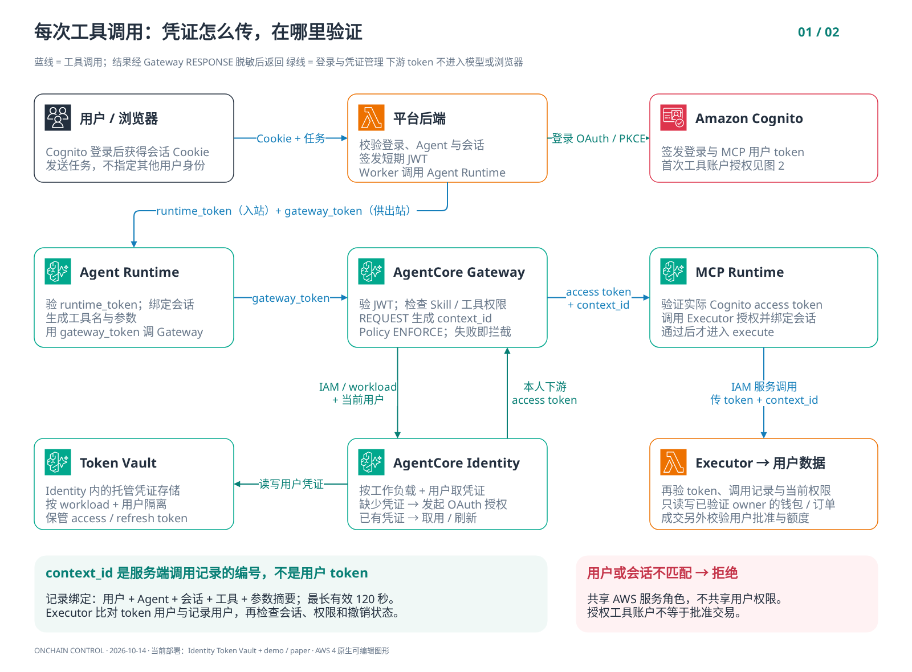
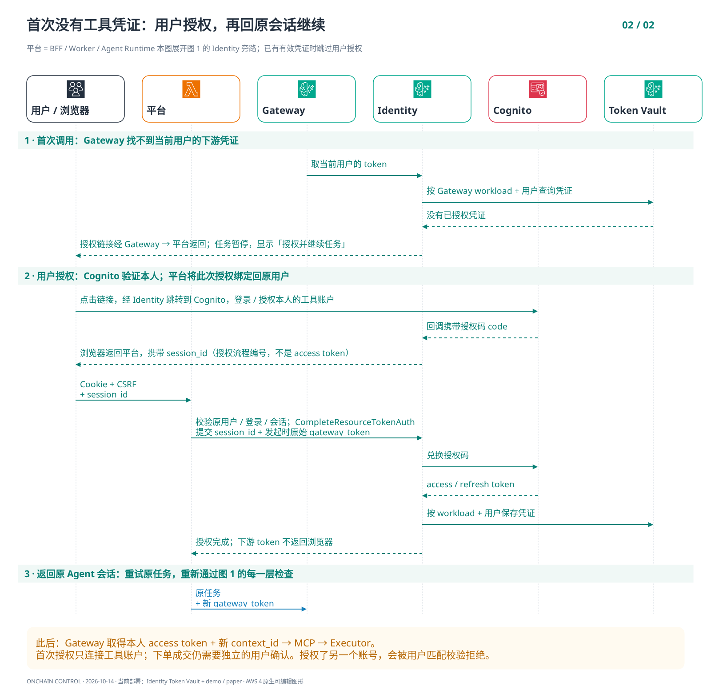

# AWS 架构图

[下载可编辑的 draw.io 文件](onchain-architecture.drawio)。文件包含三页，使用 diagrams.net
内置的 **AWS 4** 图形库，包括 Bedrock AgentCore、Bedrock、Cognito、Lambda、API Gateway、
CloudFront、S3、DynamoDB、SQS、EventBridge、KMS、Secrets Manager 和 CloudWatch 图标。
图标采用 [AWS Architecture Icons](https://aws.amazon.com/architecture/icons/) 风格，
由 diagrams.net 的 AWS 4 图形库提供。

图标、服务卡片、文字和连线均为可编辑对象，主文件不是嵌入的一张图片。
以下 PNG 用于 GitHub 预览；可点击查看原始尺寸。

要看清用户认证和凭证传递，先看 **04 数据流 → 05 首次授权**。
这两张图保存在独立的[认证流程 draw.io 文件](identity-auth-flow.drawio)，可编辑节点、AWS 图标及所有连线。

| 页面 | 内容 | PNG 预览 |
|---|---|---|
| 01 整体部署 | 前后端分离、内部与公共 Gateway、独立 Agent/MCP Runtime、执行器、数据和可选数据源接入 | [整体部署](01-aws-architecture.png) |
| 02 交易认证与拦截 | 意图准备、Cognito 重新认证、一次性确认、Gateway 拦截、原子成交、回执和撤权 | [交易流程](02-trade-control.png) |
| 03 用户会话隔离 | 卖家发布、买家购买独立 Agent、Runtime/MCP 会话绑定、数据归属与删除后的行为 | [用户隔离](03-user-isolation.png) |
| 04 认证数据流 | 用户 → Runtime → Gateway → MCP；Identity / Token Vault 提供哪种凭证；在哪里验证 | [数据与凭证](04-identity-data-flow.png) |
| 05 首次工具授权 | 缺少凭证 → Cognito 授权 → 原身份绑定 → Vault 保存 → 原会话续跑 | [授权时序](05-identity-consent.png) |

## 打开与编辑

1. 将 `onchain-architecture.drawio` 下载到本地。
2. 在最新版 [diagrams.net](https://app.diagrams.net/) 或 draw.io Desktop 中选择
   **File → Open From → Device**，打开文件。
3. 通过底部标签切换三页。服务卡片内的图标和文字也是独立图形，可以分别编辑。
4. 使用 **File → Export as → PNG / SVG / PDF** 导出需要的页面。

较旧编辑器可能没有 Bedrock AgentCore 图标；使用最新版 AWS 4 图形库即可。
主文件使用未压缩 XML，便于 Git 差异审阅。预览图已用 diagrams.net 的图形引擎渲染核对。

## 图中边界

- 描述的是本仓库已实现的平台，区域为 `us-east-1`；CloudFront 是全球边缘服务。
  Bedrock 使用 `us.openai.gpt-6-sol` 推理配置，实际模型路由由该配置决定。
- Cognito **User Pool** 为用户、外部 MCP 和下游 MCP Runtime 提供 OAuth。AgentCore Identity
  Token Vault 管理下游用户凭证；短期服务端调用记录绑定 Agent、会话、工具、参数和当前授权。
  MCP → Executor 仍使用 IAM 服务调用，同时独立验证用户 OAuth 和调用记录。
- 内部和公共 Gateway 共用 REQUEST/RESPONSE 拦截器及 Policy ENFORCE。图中的控制依赖
  不规定 Policy 与拦截器的内部调用顺序，Executor 仍须在成交前最终核验。
- 聊天及模板任务经过 Agent Runtime；已批准的单笔/定投执行由 Worker 直接调用 Gateway。
  固定模板不必再次调用模型来规划步骤。
- 第三页的 A/B 图标表示同一服务部署中的独立 Agent、Runtime session 与数据归属，
  不表示为每位用户新建一套 AWS 资源。DynamoDB 的两个数据框是逻辑 owner 分区。
- 当前为 `demo` 数据和 `paper` 交易。橙色虚线的数据源路径是可选 live
  数据接入，当前未配置；Secrets Manager 还保存 Identity provider 的 OAuth client secret；图中没有实盘 signer 或链上广播组件，也没有配置 Guardrails。

## 维护

图中关系根据以下代码核对：

- 部署资源与角色：[infra/template.py](../../infra/template.py)、[scripts/deploy.py](../../scripts/deploy.py)
- 作业与执行分流：[worker.py](../../backend/onchain/worker.py)、[scheduler.py](../../backend/onchain/scheduler.py)
- Gateway 与工具检查：[interceptors.py](../../backend/onchain/interceptors.py)、[services.py](../../backend/onchain/services.py)
- OAuth、市场与归属：[oauth.py](../../backend/onchain/oauth.py)、[marketplace.py](../../backend/onchain/marketplace.py)、[domain.py](../../backend/onchain/domain.py)

布局生成器只使用 Python 标准库：

```bash
python scripts/draw_architecture.py
python scripts/draw_identity_flow.py
```

两个生成器分别重建整体架构（三页）与认证流程（两页）文件；手工修改图后若需继续用生成器维护，也应同步修改生成器。
结构修改后重新导出对应的 PNG 预览。

## 04 · 数据与凭证传递



## 05 · 首次授权与原会话续跑



## 01 · 整体部署


## 02 · 交易认证与拦截


## 03 · 用户会话隔离


