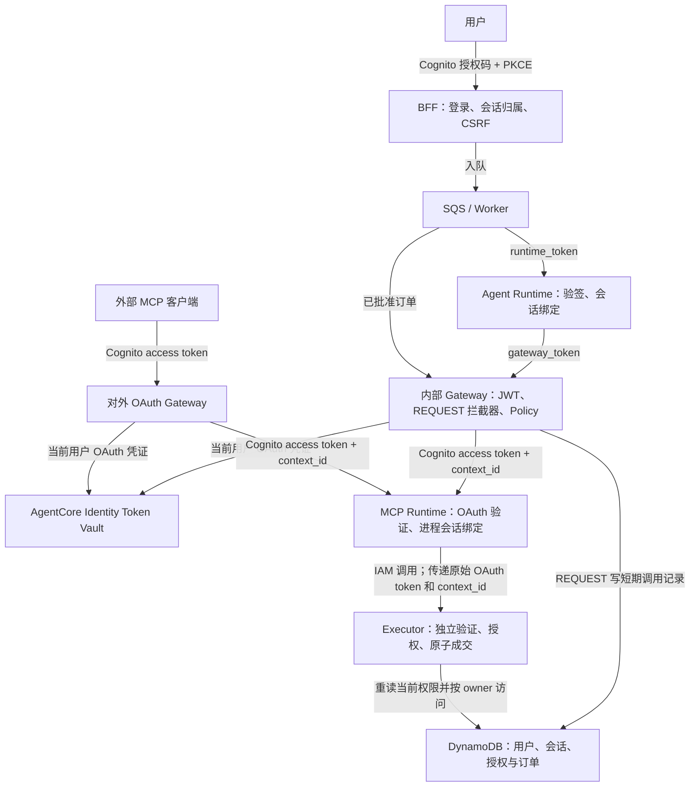

# 认证与用户隔离：实现参考

阅读流程请先看 [README 的两张图](../README.md#runtime--gateway--mcp-的认证与用户隔离)。本页保留字段、接口及异常处理细节，供开发和排查使用。

**下游用户凭证由 AgentCore Identity Token Vault 管理；平台保留会话隔离、工具授权和交易批准。**
旧的自定义 `security_context` 工具 JWT 已替换为服务端短期调用记录 `context_id`。
OAuth 证明用户身份；记录绑定当前 Agent、会话、工具和参数；具体成交仍需要独立的用户批准。
没有使用 Guardrails，模型不能授予权限或批准交易。

## 调用路径与凭据



REQUEST 拦截器与 Policy 都必须通过，不假定它们在 AWS 内部的先后顺序。
Gateway 使用 `OAUTH / AUTHORIZATION_CODE` 下游凭据配置，不再使用 `GATEWAY_IAM_ROLE` 调用 MCP。
IAM 仍用于 AWS 服务操作，例如读取 Token Vault 和 MCP 调用指定 Executor Lambda；IAM 角色不表示终端用户。

| 凭据 / 标识 | 来源与用途 | 验证 / 生命周期 |
|---|---|---|
| 登录 Cognito token | BFF 保管网页登录凭证；外部客户端通过自己的 PKCE 流程获得入口 token | issuer、client、scope、外部 Gateway audience；access token 15 分钟 |
| `runtime_token` | BFF/调度器签发，Worker → Agent Runtime | KMS RS256，`aud=onchain-runtime`，300 秒 |
| `gateway_token` | BFF/调度器签发，Agent Runtime/Worker → 内部 Gateway | KMS RS256，`aud=onchain-gateway`，300 秒 |
| Workload access token | AgentCore Identity 为已认证工作负载提供的凭证 | 用于访问 Identity 凭据 API，不能作为 MCP 下游 bearer token |
| 下游 Cognito access token | 用户授权后由 Token Vault 保管、刷新；Gateway → MCP 的 Authorization header | 专用 confidential client、MCP Runtime 完整调用 URL audience、`openid` scope、access token 类型和时间 |
| `context_id` | REQUEST 拦截器生成的随机引用，注入下游工具参数 | 最长 120 秒，并受入口 token/用户 OAuth 到期时间限制；单独持有不能访问工具 |

Token Vault 管理的是下游 OAuth access/refresh token。网页登录的 BFF refresh token 仍使用现有 KMS 加密存储，
两者是不同用途。下游 token 不进入浏览器、Agent 模型、工具参数、会话历史或审计结果；MCP 将其传给可信 Executor 以便独立验签。
内部执行 JWT 仍然存在；本次移除的是自定义工具授权 JWT，而非全部平台身份代码。

## 服务端调用记录如何绑定用户

REQUEST 在检查全部权限后创建 `CALL#SHA256(context_id)`。数据库 TTL 负责清理，代码仍在每次调用中主动检查过期，
不依赖 DynamoDB TTL 删除时间。记录包含：

| 字段 | 约束 |
|---|---|
| `sub`、`tenant`、`owner` | Cognito 用户；个人租户为 `personal-{sub}`，owner 为 `SHA256(tenant + ":" + sub)` |
| `agent_id`、`sid`、`runtime_sid`、`run_id` | 本次调用的 Agent、应用会话、Runtime 会话和运行 |
| `agent_epoch`、`session_epoch`、`skill_digest` | 当前授权版本与已审核 Skill |
| `tool`、`arguments_hash` | 确切工具及排序 JSON 的 SHA256；订单 ID 也在摘要内 |
| 连接 key / epoch、`expires_at` | 内部或外部工具连接版本及短期有效期 |

客户端不能提交 `context_id`、`userId` 或旧 `security_context`；严格工具 schema 会拒绝额外参数。
MCP/Executor 从实际 Cognito token 得到用户，与记录中的 owner/sub 比较，再重读当前业务权限。
数据库引用被其他用户取得也不能使用；仅通过 OAuth 验签同样不能跳过有效调用记录。

## 每一层如何验证

1. **BFF 与 Worker。** Cognito 登录建立 HttpOnly、SameSite=Strict 服务端会话。修改操作要求 CSRF；
   入队要求会话属于当前用户和当前登录。签发绑定 Agent/会话/run 的 Runtime/Gateway JWT，Worker 再次验证当前状态。
2. **Agent Runtime。** AgentCore JWT authorizer 和应用验签；比较实际 Runtime session header、请求体及 JWT 中的 ID。
   `SessionBinding` 锁定 `(owner, sid, runtime_sid)`；模板还验证任务摘要。每次 Gateway 调用创建独立 MCP 客户端会话。
3. **Gateway。** 内部入口验证平台 JWT；外部入口验证 Cognito JWT。REQUEST 独立检查 owner、会话、Agent 状态、epoch、
   Skill、scope、订阅、工具 schema、速率和操作权限。内部 MCP session 绑定 `(owner, sid, run_id)`。通过后写调用记录。
   Cedar Policy 保持 `ENFORCE`；RESPONSE 按权限过滤 tools/list，隐藏内部参数并脱敏结果。
4. **Identity 与下游 OAuth。** Gateway 为当前用户使用 Token Vault 的授权码凭据 provider。
   首次无凭证时产生授权请求；已有凭证由托管服务取用和刷新。专用 Cognito client 的回调只允许 Identity callback。
5. **MCP Runtime。** AgentCore 入站 JWT authorizer 检查 Cognito client/audience/scope；应用再验证签名、issuer、时间、
   `token_use=access`。先调用 Executor 的 `authorize` 阶段取回已验证的 owner/session，完成进程身份绑定后才调用 `execute`。
   MCP Role 只能调用指定 Executor，没有数据库权限或平台签名权限。
6. **Executor。** 两个阶段都独立验证原始 Cognito token、调用记录的 owner/tool/参数/有效期/连接版本，并重读当前授权。
   访问钱包和订单只使用验证后的 owner；订单还必须属于该 Agent。成交重新检查批准、意图摘要、余额、持仓、价格、滑点、
   grant 与额度；原子更新状态并保存幂等回执。校验或依赖失败均拒绝执行。

## 首次授权、返回与撤销

工作台遇到首次工具授权时显示「授权并继续任务」。后端保存有限续跑记录，包含原会话、原任务和 KMS 加密的原始入站 JWT 证明；有效期不超过原 JWT 到期时间（内部调用最长 5 分钟）。
浏览器到 Cognito 授权后经 Identity 返回平台；同源、CSRF 保护的完成请求调用 `CompleteResourceTokenAuth`，
在验证当前登录仍属于原用户后，解密并提交发起流程时的原始 JWT 完成 AWS 会话绑定。
AWS 的完成接口要求原始 JWT；仅重新签发同一 issuer/sub 的 token 会被拒绝。成功后立即移除这份短期加密证明。续跑还要求原用户、原登录及原会话。
成功后回到原 Agent 会话，为原任务重新签发短期执行凭据；授权本身不批准任何订单。

「MCP / Skill 管理 → 工具账户连接」可预先连接平台内 Agent。BFF 选择本人已启用 Agent 的一个获准只读工具，
通过实际 Gateway 发起连接检查；缺少凭据时返回该 Gateway 的授权链接，已有有效凭据时直接完成检查。
独立 BFF workload 的 Vault 授权不能预授权 Gateway；服务关联的 Gateway workload 也不允许 BFF 直接获取其 workload token。
两个 Gateway 的 workload 不同，入口 issuer 也不同，因此分别显示两条连接；两条都必须授权本人账户。
若下游授权了另一个 Cognito 用户，Executor 的 owner 比较会拒绝调用。
外部客户端先取得 Cognito 入口 token 和用户批准的 MCP 连接，再调用工具。首次调用返回原生 URL 授权挑战。
需使用 **MCP 2025-11-25 或更新版本，并在后续请求中发送相同的 `MCP-Protocol-Version` header**。
RESPONSE 拦截器验证原入口身份，将原始 JWT 加密绑定到授权 URI、当前 MCP 会话和连接版本；网页回调要求同一用户登录及 CSRF。
授权后由外部客户端重试工具调用。网页不会收到 Vault token，也不接受客户端自报 userId。
回调角色需要 `CompleteResourceTokenAuth`，以及仅针对该 Identity provider 的 OAuth client secret 的 `secretsmanager:GetSecretValue`。
Identity 在完成授权码兑换时使用这项权限；缺少它会导致授权失败。BFF 不读取下游 access/refresh token。

撤销连接会递增服务端 epoch 并置为 inactive。Gateway 不再创建调用记录，Executor 拒绝旧引用，
即使 Vault 中的 access token 尚未过期也不能执行。该操作撤销本平台的工具权限，**不声称删除了 Token Vault 中的提供方 token**。
「恢复工具访问」是已登录用户恢复平台权限的明确操作；Vault 中仍有效的本人凭据可复用，不强制重复提供方授权。
暂停/删除 Agent、撤销持续授权、退出交互登录仍有各自独立的失效规则。已经完成的成交不会被撤回。

以“用 20 USDC 买入 ETH”为例：工具 OAuth 连接 → 查询与准备 PENDING 订单 → 用户核对 → Cognito 操作级重新认证 →
消费绑定订单和意图摘要的 120 秒一次性证明 → 批准 → Worker 经相同 Gateway/MCP/Executor 链路执行该订单。
连接成功、`trade.execute` scope 或模型输出均不能替代订单批准。

## 用户隔离与实际边界

| 对象 | 隔离实现 |
|---|---|
| Token Vault 用户 | 依据 workload 和用户身份关联提供方凭证；两个 Gateway 分开授权，同一 Gateway 下 Agent/会话仍须单独校验 |
| 用户数据 | Cognito sub 派生 owner；按 `USER#{owner}` 查询，所有历史与订单访问检查 owner |
| Agent / 应用会话 | 服务端归属、状态、epoch、Skill 和登录绑定；每会话独立 Runtime ID |
| Runtime 执行环境 | Agent/MCP 进程绑定首个已验证用户与会话，变化立即拒绝 |
| 外部 MCP | owner、client、token family、连接版本和 MCP session 共同绑定 |
| 买卖双方 | 买方获得自己拥有的 Agent；卖方不能读取买方会话或操作买方钱包 |
| 防重放 | 调用记录短期有效；订单依靠原子状态转换和幂等回执防止重复扣款 |

多个用户仍共享 Runtime 部署、服务角色和数据库，未实现每用户独立 IAM Role、表或数据库层 ABAC。
两个 Runtime 使用 `networkMode=PUBLIC`，MCP 是经过 JWT 认证的后端端点，不是 VPC 私网端点。
移除旧的 Gateway-only IAM 资源策略后，MCP 入口可由有效下游 JWT 到达；工具执行还必须具有有效调用记录并通过完整业务校验。
`context_id` 在有效期内允许重试，不是一次性交易授权；撤销不回滚已经提交的副作用。

## 实现与验证入口

[Token Vault 配置](../scripts/identity_setup.py)、[授权与续跑](../backend/onchain/identity.py)、
[调用记录与 OAuth 验证](../backend/onchain/invocations.py)、[BFF API](../backend/onchain/api.py)、
[Gateway 拦截器](../backend/onchain/interceptors.py)、[MCP Runtime](../runtimes/mcp_server.py)、
[Executor](../backend/onchain/services.py)、[用户与交易权限](../backend/onchain/domain.py)、[部署](../scripts/deploy.py)。

```bash
.venv/bin/pytest -q tests/test_identity_vault.py tests/test_security.py tests/test_oauth.py
```

测试覆盖错误 issuer/audience/client/token 类型/scope、跨用户引用、参数替换、过期、连接撤销、会话关闭、
MCP 执行前身份绑定、回调 CSRF/登录绑定、续跑防重复及凭证脱敏。真实 AWS 验证记录见 [部署文档](deployment.md)。
Token Vault 不提供业务交易授权；更多边界见 [安全设计](security.md)。
